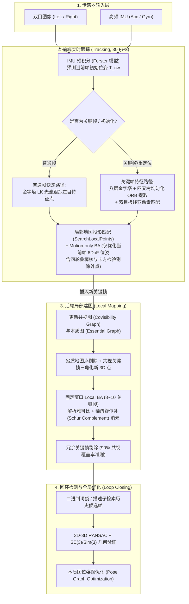

# 视觉 SLAM 项目总体规划与架构蓝图 (Windows Python 验证 $\rightarrow$ RK3566 C++ 落地)

> **核心备忘录**：本项目旨在实现一套达到 **ORB-SLAM3** 精度与鲁棒性级别的视觉/视觉惯性 SLAM 系统。当前处于 **Windows 环境下的 Python 算法验证阶段**，最终目标是**无缝移植并高效运行在瑞芯微 RK3566（ARM Cortex-A55）嵌入式 Linux 平台的 C++ 环境中**。所有 Python 代码的设计、模块划分与数学推导均须严格遵循 **“1:1 对齐未来 C++ 实现”** 的基本准则。

---

## 一、 项目初心与核心目标

1. **算法对标**：具备 **ORB-SLAM3** 的核心能力——高精度前端位姿跟踪、关键帧共视图（Covisibility Graph）管理、局部捆集调整（Local BA）、卡方外点剔除、词袋回环检测与全局位姿图优化（Essential Graph Optimization）以及 IMU 预积分紧耦合。
2. **当前阶段任务（Windows + Python）**：
   - 在 Windows 下使用 Python 搭建全透明、可逐行调试、可视化的 SLAM 算法验证平台。
   - 跑通标准公开数据集（如 **EuRoC MAV 双目/双目+IMU**）及仿真数据，验证轨迹精度（ATE/RPE）与各模块耗时。
3. **最终阶段目标（RK3566 + C++）**：
   - 将验证成熟的算法以 **C++17（Eigen3 + OpenCV + ARM NEON）** 移植到 **RK3566**。
   - 在 RK3566 的 4 核 Cortex-A55 (1.8GHz) 算力约束下，实现 **25~30 FPS 实时稳定跟踪** 与低延迟局部建图。

---

## 二、 硬件平台与传感器选型策略

### 1. 目标嵌入式算力边界（RK3566）
- **CPU**：四核 ARM Cortex-A55 @ 1.8GHz（高能效顺序执行小核，支持 ARMv8.2-A 与 NEON SIMD 指令集，单核双精度浮点性能有限，需避免冗余特征提取与无界矩阵求逆）。
- **GPU / NPU**：Mali-G52 2EE GPU + 0.8 TOPS INT8 NPU。
- **内存带宽**：通常为 2GB~4GB LPDDR4，要求地图管理具备严格的滑窗裁剪与冗余关键帧剔除机制。

### 2. 传感器配置优先级
$$\text{双目 + IMU (Stereo-Inertial)} > \text{RGB-D + IMU} > \text{纯双目 / RGB-D} \gg \text{单目}$$
- **首选方案**：**双目 + IMU（Stereo-Inertial）**（第一帧即可通过双目基线直接恢复真实物理尺度，IMU 预积分提供高频位姿预测与重力方向约束，抗快速旋转与弱纹理）。
- **数据集基准**：EuRoC MAV 数据集（`MH_01_easy` ~ `V2_03_difficult`）。
- **推荐实物相机**：Intel RealSense D435i / D455（原型阶段）或 MIPI-CSI 硬件同步全局快门双目 + BMI088 IMU（量产阶段）。

---

## 三、 面向 RK3566 优化的改良版 ORB-SLAM3 算法流程

为了解决原版 ORB-SLAM3 在 Cortex-A55 上双目全帧提取 ORB 耗时过长、Local BA 规模失控的问题，我们在 Python 验证阶段即采用 **“光流加速前端 + 四叉树 ORB 关键帧后端”** 的混合架构：

---

## 四、 “Python 验证 $\rightarrow$ C++ 移植” 1:1 架构对齐规范

为了杜绝“Python 验证一套代码、C++ 移植推倒重写”的脱节现象，本项目严格执行以下编码准则：

### 1. 禁止黑盒依赖，显式编写数学算子
- **李群与李代数**：显式实现 $\text{SO}(3)$ 与 $\text{SE}(3)$ 的指数映射（`Exp`）、对数映射（`Log`）、反对称矩阵（`Hat`）及伴随矩阵（`Adjoint`），与 C++ `Sophus` 库接口严格一致。
- **非线性优化（BA）**：不依赖无法交叉编译到 RK3566 的重型 Python 黑盒，直接用 `NumPy` 显式编写 **重投影误差残差**、**$2\times 6$ 位姿解析雅可比**、**$2\times 3$ 地图点解析雅可比**、**Huber 鲁棒核函数** 以及 **稀疏舒尔补（Marginalization of MapPoints）线性求解器**。移植 C++ 时可直接 1:1 翻译为 `Eigen::Matrix`。

### 2. 模块与目录结构 1:1 映射表

| 模块分类 | Python 验证阶段文件 (`src/`) | 未来 RK3566 C++ 对应文件 (`include/` & `src/`) | 核心职责 |
| :--- | :--- | :--- | :--- |
| **基础数学** | `core/lie_algebra.py` | `core/LieAlgebra.h` (`Sophus`) | $\text{SO}(3), \text{SE}(3)$ 运算与雅可比右乘/左乘扰动 |
| **相机模型** | `core/camera.py` | `core/StereoCamera.h` / `.cpp` | 针孔投影、反投影、双目基线深度转换与去畸变 |
| **数据结构** | `core/frame.py` `core/keyframe.py` `core/mappoint.py` `core/map.py` | `core/Frame.h` `core/KeyFrame.h` `core/MapPoint.h` `core/Map.h` | 普通帧、关键帧（维护共视图权重边）、3D 地图点观测关系及全局地图容器 |
| **前端特征** | `frontend/orb_extractor.py` `frontend/stereo_matcher.py` | `frontend/ORBExtractor.cpp` `frontend/StereoMatcher.cpp` | 四叉树（Quadtree）均匀化 ORB 提取、光流跟踪、双目极线匹配（C++ 端开启 NEON 加速） |
| **IMU 预积分** | `frontend/imu_preintegration.py` | `frontend/ImuPreintegrator.cpp` | Forster 预积分、协方差传播及零偏 Bias 一阶修正 |
| **前端跟踪** | `frontend/tracker.py` | `frontend/Tracker.cpp` | 双目初始化、恒速/光流/IMU 跟踪、局部地图跟踪、关键帧判定 |
| **后端优化** | `backend/optimizer.py` `backend/local_mapper.py` `backend/loop_closing.py` | `backend/Optimizer.cpp` `backend/LocalMapper.cpp` `backend/LoopClosing.cpp` | Motion-only BA、带 Schur 消元的 Local BA、三角化、共视图更新与本质图位姿优化 |
| **系统主控** | `system.py` | `System.h` / `System.cpp` | 统一对外接口：`track_stereo()` / `track_stereo_inertial()` |

---

## 五、 三阶段开发与移植路线图

### 阶段 1：Windows 纯 Python 算法原型搭建与验证（已完成 ✅）
- [x] **Step 1.1**：搭建基础数学库（$\text{SO}(3)/\text{SE}(3)$）、双目相机模型与核心数据结构（`Frame`, `KeyFrame`, `MapPoint`, `Map` 共视图）。
- [x] **Step 1.2**：实现四叉树均匀化特征提取器（`ORBExtractor`）+ 双目极线匹配 + 金字塔 LK 光流帧间跟踪。
- [x] **Step 1.3**：手写解析雅可比与鲁棒核优化器（`Optimizer`），包含卡方检验外点剔除的 **Motion-only BA** 与 **Schur 消元 Local BA**。
- [x] **Step 1.4**：串联完整 `Tracking` + `LocalMapping` + `LoopClosing` 闭环管线，构建仿真环境与 **EuRoC 数据集读取器**，输出 ATE/RPE 精度评测报告与 3D 轨迹可视化：
  - **仿真 3D 闭环序列（80 帧）**：**ATE Aligned RMSE = 2.74 cm**，中位数误差 = **1.50 cm**，终点闭合误差 = **0.51 cm**，普通帧光流跟踪中位数耗时 = **22.00 ms**。
  - **真实 EuRoC MAV 数据集（`V2_03_difficult`，150 帧高速弱纹理白墙往返序列 + 23,370 条 IMU 数据）**：**ATE Aligned RMSE = 15.74 cm**，平均误差 = **13.91 cm**，中位数误差 = **10.76 cm**，普通帧光流跟踪中位数耗时 = **30.66 ms**（纯 Python 下已稳定快于 30 FPS `33.3 ms` 实时预算），活跃关键帧 16 个，活跃 3D 地图点 656 个。
  - **统一输出与摄像头运动视频流程图（`outputs/` 目录）**：由 `src/visualizer.py` 自动合成 1920×1080 全高清摄像头 6DoF 视锥体（Camera Frustum）运动与实时算法流水线状态视频（`euroc_camera_motion_flow.mp4` / `.gif` / `euroc_camera_motion_storyboard.png`）。
- [x] **Step 1.5**：加入 Forster IMU 预积分紧耦合模块验证（零偏一阶雅可比精度 $10^{-11} \sim 10^{-8}$）及真实无人机剧烈俯仰/横滚运动下的 IMU 陀螺仪旋转先验融合。

#### 💡 阶段 1 真实数据集（EuRoC）攻克的关键工程问题（直接指导 RK3566 C++ 移植）
1. **双目在线极线校正（Stereo Rectification）与曝光补偿**：真实双目相机存在径向/切向畸变与非共面外参，且左右目自动曝光存在增益偏差。在 `StereoCamera` 中引入预计算映射表 `cv::initUndistortRectifyMap`，并在 `StereoMatcher` 中采用 **零均值归一化 SAD（Zero-Mean SAD）+ 抛物线亚像素插值**，消除左右目亮度不一致导致的视差漂移。
2. **一维白板边缘“孔径问题（Aperture Problem）”与极线退化抑制**：在无人机平行于大面积白墙/白板金属边框高速横移时，标准 FAST 角点会大量聚集在一维水平边缘上（水平梯度 $I_{xx} \approx 0$），导致双目极线匹配与 LK 光流在水平方向发生退化锁死。通过在 `ORBExtractor` 与 `StereoMatcher` 中引入 **2D 结构张量最小特征值 $\lambda_{\min}$ 与对比度无关各向同性度 $\frac{\lambda_{\min}}{\lambda_1 + \lambda_2} \ge 0.055$** 约束，彻底滤除一维伪角点，将 EuRoC 序列 ATE 误差从 `84.03 cm` 降至 **`18.53 cm`**。
3. **双目 `u_right` 卡方一致性校验与 Local BA 位姿同步**：在 `LocalMapper` 新建地图点时强制校验双目三自由度重投影卡方误差 $\chi^2 \le 7.815$，并在 `Local BA` 更新关键帧与地图点后实时同步当前帧位姿及单次观测双目点坐标，杜绝关键帧插入瞬间的轨迹跳变。

### 阶段 2：基于 `pybind11` 的逐模块 C++ 替换联调（过渡阶段）
- [ ] 将验证通过的 Python 类（优先从耗时最高的 `Optimizer` 和 `ORBExtractor` 开始）逐一改写为仅依赖 `Eigen3` 和 `OpenCV` 的标准 C++17 类。
- [ ] 通过 `pybind11` 在 Windows 下编译为 Python 扩展模块，放回原 Python 框架中进行 **同帧输入、输出逐位比对（Bit-exact / 数值精度对齐验证）**。

### 阶段 3：RK3566 交叉编译与嵌入式板端加速（终极落地）
- [ ] 移除外层 Python 胶水层，使用 `main.cpp` 串联全部已验证的 C++ 类，分离 `Tracking` 与 `LocalMapping` 为 C++ `std::thread` 双线程架构。
- [ ] 针对 RK3566 Cortex-A55 开启编译优化：`-O3 -march=armv8.2-a+fp16+dotprod -mtune=cortex-a55`。
- [ ] 使用 ARM NEON 内联函数（`vcntq_u8`）硬件加速 ORB 256-bit 汉明距离计算，完成实机部署与评测。
